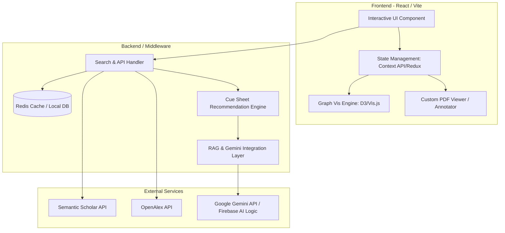

# 제품 요구사항 정의서 (Product Requirement Document, PRD)

## 1. 개요 및 비전 (Overview & Vision)

- **제품명**: Papers-SR-Assistant (논문 읽기 큐시트 & 문헌 탐색 어시스턴트)
- **목적**: 단순 키워드 검색을 넘어, 인용 네트워크(Citation Network)와 시간축(Timeline)을 결합하여 학술 연구의 계보를 시각화하고, AI 기반의 개인화된 **'읽기 큐시트(Reading Cue Sheet/Roadmap)'**를 제안하여 연구자가 새로운 도메인에 빠르게 진입할 수 있도록 돕는 리서치 어시스턴트 웹앱입니다.
- **차별화 포인트**: ResearchRabbit, Connected Papers 등 기존 문헌 탐색 도구들이 제공하지 못하는 **"어떤 순서로 논문을 정독해야 가장 효율적인가(Prerequisites & Reading Order)"**에 대한 논리적 로드맵과 학습 순서를 제공하고, 수식/코드/표에 특화된 AI 설명 기능을 제공합니다.

---

## 2. 타겟 유저 및 페르소나 (Target Audience)

1. **대학원생 및 신진 연구자**:
   - 새로운 연구 분야를 탐색하거나 학위 논문을 작성할 때, 어디서부터 읽기 시작해야 할지 모르는 유저.
   - 선행 지식이 부족하여 난이도가 높은 후속 논문을 먼저 읽다가 병목이 생기는 유저.
2. **머신러닝/컴퓨터공학 엔지니어 및 연구원**:
   - 매일 쏟아지는 최신 아키텍처 및 성능 최적화 논문 중에서 핵심적인 이론 계보를 빠르게 파악하고, 모델 구조/평가 지표/데이터셋 요약을 신속히 확인하려는 유저.
3. **체계적 문헌고찰(Systematic Review)을 수행하는 전문가**:
   - 특정 주제에 대한 선행 연구(Prior Works)와 후속 연구(Derivative Works)를 연도별 역사적 흐름에 따라 매핑하고 비교표를 작성해야 하는 연구자.

---

## 3. 핵심 사용자 문제 및 해결 방안 (Core Problem & Solution)

### 문제 1: 리스트 형태 검색의 구조적 한계

- **현상**: Google Scholar나 PubMed 등 기존 검색엔진은 평면적인 목록만 제공하여, 논문 간의 인용 계보와 발전 흐름을 파악하기 어렵습니다.
- **해결**: 인용 및 피인용 데이터를 활용해 **시간축(X축) 기반의 양방향 인용 네트워크 그래프**를 제공하여 논문의 계보를 시각적으로 한눈에 파악하게 합니다.

### 문제 2: "어떻게(어떤 순서로) 읽어야 하는가"에 대한 가이드 부재

- **현상**: 유사 논문을 발견해도 이를 정독할 때 난이도와 선행 기술 관계를 몰라 학습 비효율이 발생합니다.
- **해결**: AI가 논문 간의 선행 관계(Prerequisites)와 인용 그래프의 깊이를 분석하여 **"추천 읽기 순서(Cue Sheet)"**와 **단계별 추천 사유**를 자동으로 제안합니다.

### 문제 3: ML/CS 도메인의 높은 수학적/기술적 장벽

- **현상**: 논문 내 복잡한 수식(Equations), 표(Tables), 수도코드(Pseudo-code)를 이해하는 데 많은 시간이 소요됩니다.
- **해결**: PDF 뷰어 내에서 수식과 표를 드래그/하이라이트하면 자연어로 직관적인 해설을 제공하는 **AI 리서치 어시스턴트 패널**을 내장합니다.

---

## 4. 기능적 요구사항 (Functional Requirements)

### 4-1. 키워드 및 시드 논문 기반 문헌 발견 (Discovery)

- **[FR-1.1] 학술 검색**: 사용자가 키워드, DOI, arXiv ID, 혹은 논문 제목을 입력하면 관련 논문을 검색합니다.
- **[FR-1.2] 시드 논문(Seed Papers) 설정**: 검색 결과에서 1개 이상의 논문을 '시드(Seed)'로 추가하여, 관련 네트워크를 점진적으로 확장할 수 있습니다.
- **[FR-1.3] 추천 엔진 랭킹**: Co-citation(공동 인용), Bibliographic Coupling(서지 결합), 추상(Abstract) 유사도 임베딩을 조합하여 연관 논문을 추천합니다.

### 4-2. 시간축 기반 인용 네트워크 시각화 (Visualization)

- **[FR-2.1] 계보 뷰 (Timeline Graph)**:
  - X축은 논문 발행 연도(Timeline), Y축은 인용 영향도 또는 유사도 축으로 구성된 양방향 노드-링크 시각화를 제공합니다.
  - 노드 크기는 피인용 수(Citation Count)에 비례하며, 노드 색상은 발행 연도 또는 Seed와의 유사도에 따라 다르게 매핑됩니다.
- **[FR-2.2] 관계 필터링**:
  - 선택한 논문의 선행 연구(Prior Works), 후속 연구(Derivative Works), 유사 연구(Similar Papers)를 필터링하여 시각화할 수 있습니다.

### 4-3. AI 기반 논문 읽기 큐시트 생성 (Cue Sheet Roadmap - 핵심 기능)

- **[FR-3.1] 로드맵 자동 생성**:
  - 선택된 논문 컬렉션 내에서 논문 간의 참조 관계와 개념적 선행 관계를 기반으로 **'최적 학습/읽기 경로(Cue Sheet)'**를 도출합니다.
  - 예: `[기초 이론/아키텍처 제안 논문]` $\rightarrow$ `[개선 모델 논문]` $\rightarrow$ `[인퍼런스 최적화 및 응용 논문]`.
- **[FR-3.2] 단계별 추천 근거 제시**:
  - 왜 이 순서로 읽어야 하는지 각 단계마다 자연어 근거를 표시합니다.
  - 예: _"이 논문은 Transformer 아키텍처를 최초 제안하여 이후 읽을 3개 논문의 기반이 되므로 가장 먼저 읽어야 합니다."_
- **[FR-3.3] 큐시트 수동 편집**:
  - 사용자는 추천된 순서를 드래그 앤 드롭으로 변경하거나 메모를 추가할 수 있습니다.

### 4-4. AI 리서치 어시스턴트 & 요약 패널 (AI Assistant Panel)

- **[FR-4.1] 구조화된 요약 제공**:
  - 논문 선택 시 한 줄 요약(TL;DR), 핵심 기여(Contribution), 사용 데이터셋(Dataset), 사용된 평가지표 및 성능(Metric & Results), 한계점(Limitations)을 추출하여 표 형태로 한눈에 보여줍니다.
- **[FR-4.2] 다국어(한국어) 요약 및 번역**:
  - 영어 논문에 대해 완성도 높은 한국어 요약을 기본 제공하며, 사용자가 요청 시 수식과 그림 레이아웃을 깨뜨리지 않고 전체/부분 번역을 지원합니다.
- **[FR-4.3] 수식/도표 인라인 해설**:
  - PDF 리더 화면에서 복잡한 수식이나 표를 하이라이트/선택하면 해당 수식의 물리적 의미나 표의 핵심 지표를 설명해 주는 인터랙티브 Q&A 기능을 제공합니다.

### 4-5. 컬렉션 관리 및 협업/내보내기 (Integration)

- **[FR-5.1] 내보내기 기능**: 큐시트 및 분석된 문헌 매트릭스를 Markdown(.md), CSV, BibTeX 파일로 내보낼 수 있습니다.
- **[FR-5.2] 외부 도구 연동 (옵션)**: Zotero 라이브러리 및 Notion 데이터베이스와의 연동을 지원하여 원클릭으로 문헌을 저장합니다.
  - 모든 사용자가 사용하는 기능이 아니므로 **옵션 기능**으로 제공합니다 — 기본 비활성, 사용자가 설정에서 활성화. (2026-07-11 범위 조정: 구현 보류)

---

## 5. 비기능적 요구사항 (Non-Functional Requirements)

### 5-1. 성능 및 렌더링 (Performance)

- **그래프 렌더링**: 최대 150개의 논문 노드가 렌더링될 때 프레임 드롭 없이 부드럽게 줌/팬이 가능해야 합니다. (D3.js Force-Directed Graph 또는 Vis.js Canvas 엔진 사용)
- **초기 로딩**: 외부 학술 API 호출 시 응답 속도를 개선하기 위해, 검색 빈도가 높은 논문 메타데이터와 인용 네트워크 데이터는 캐싱 레이어를 둡니다.

### 5-2. 디자인 및 사용성 (UI/UX)

- **Rich Aesthetics**:
  - 어두운 배경에 세련된 네온/그라데이션 포인트를 활용한 Sleek Dark Mode를 기본 제공합니다.
  - 글래스모피즘(Glassmorphism) 스타일의 측면 패널과 매끄러운 뷰 전환 애니메이션을 탑재하여 몰입감 있는 탐색 환경을 구현합니다.
- **화면 레이아웃 구성**:
  - **좌측 패널**: 프로젝트/컬렉션 관리 및 큐시트 로드맵 리스트.
  - **중앙 패널**: 타임라인 및 인용 네트워크 그래프 시각화.
  - **우측 패널**: 선택한 논문의 AI 요약, 메타데이터 표, 수식 설명 및 챗봇 인터페이스.
- **반응형 웹**: 다양한 스크린 해상도를 지원하며, 태블릿 환경에서도 그래프 탐색이 매끄러워야 합니다.

### 5-3. 데이터 소스 및 정확도 관리

- **하이브리드 데이터**: **Semantic Scholar API / OpenAlex API**의 학술 데이터 코퍼스를 조합하여 광범위한 논문 커버리지를 보장합니다.
- **환각(Hallucination) 방지**: 요약 및 Q&A 수행 시, 반드시 원본 PDF/Abstract의 텍스트에 기반한 컨텍스트 내 답변(Retrieval-Augmented Generation, RAG)을 유도하고 답변 근거(Citation)를 문장 단위로 표기합니다.

---

## 6. 시스템 아키텍처 (System Architecture)

### 아키텍처 주요 구성

1. **Frontend (React + Vite)**: Canvas 기반 시각화 및 드래그 앤 드롭 큐시트 작성을 지원하는 SPA.
2. **Roadmap Generator**: 인용 네트워크(DAG, Directed Acyclic Graph)의 위상 정렬(Topological Sort)과 LLM의 초록 분석을 결합하여 난이도 및 연구 논리를 분석하고 읽기 순서를 결정하는 모듈.
3. **RAG & LLM (Gemini API + 로컬 Ollama 폴백)**: 인코딩된 초록 및 발췌 본문 데이터를 바탕으로 한글 한 줄 요약, 수식 설명, 큐시트 추천 사유 생성을 전담.
   - **하이브리드 프로바이더**: Gemini API 키가 설정된 경우 Gemini 를 사용하고, 키가 없는 경우 로컬 LLM(**Ollama**, `http://localhost:11434`)으로 자동 폴백한다. 둘 다 불가하면 규칙 기반 시뮬레이터로 동작해 앱이 항상 응답 가능해야 한다.

---

## 7. 단계별 개발 로드맵 (Phased Implementation Plan)

### Phase 1: MVP 개발 (기초 탐색 및 그래프 시각화)

- 키워드 및 DOI 기반 Semantic Scholar API 연동 검색 기능 구현.
- D3.js 기반의 연도별 타임라인 인용 네트워크 그래프 렌더링.
- 사용자가 검색한 논문을 저장하고 드래그 앤 드롭으로 직접 정렬할 수 있는 기초 큐시트 기능.

### Phase 2: AI 기능 연동 (큐시트 자동화 및 수식 해설)

- Gemini API를 연동하여 논문 컬렉션 입력 시 AI 읽기 큐시트(순서 및 추천 근거) 자동 제안 알고리즘 구현.
  - **API 키 부재 시 로컬 LLM(Ollama) 자동 폴백** 지원 — 키 없는 환경에서도 AI 기능 동작 보장. (2026-07-11 추가)
- PDF 뷰어 탑재(pdf.js) 및 수식/표 영역 지정 해설 기능 추가. (2026-07-11 pdf.js 사용 확정)
- 한글 1줄 요약(TL;DR) 및 문헌 정보 매트릭스 표 자동 추출 기능 추가.

### Phase 3: 플랫폼 확장 및 협업

- Notion, GitHub, Zotero 등 타 플랫폼 연동 및 내보내기 구현 — **옵션 기능**(기본 비활성). (2026-07-11 범위 조정: 구현 보류)
- 다인 연구 협업을 위한 큐시트 공유 링크 생성 기능.
- **실시간 다인 협업 백엔드**: 공유 세션 기반으로 여러 연구자가 동일 큐시트를 실시간 공동 편집할 수 있는 백엔드(WebSocket 동기화) 구현. (2026-07-11 구체화)
- 개인화 추천 모델 정교화 (유저 상호작용 피드백 반영).

---

## 변경 이력 / Changelog

| 날짜 | 유형 | 내용 | 영향 파일 |
|---|---|---|---|
| 2026-07-11 | F/NF/SCOPE | LLM 하이브리드(Gemini → Ollama 로컬 폴백) 추가, PDF 뷰어 pdf.js 확정, Zotero·Notion 연동 옵션화(구현 보류), 실시간 다인 협업 백엔드(WebSocket) 명시 | README.md, README.en.md |
